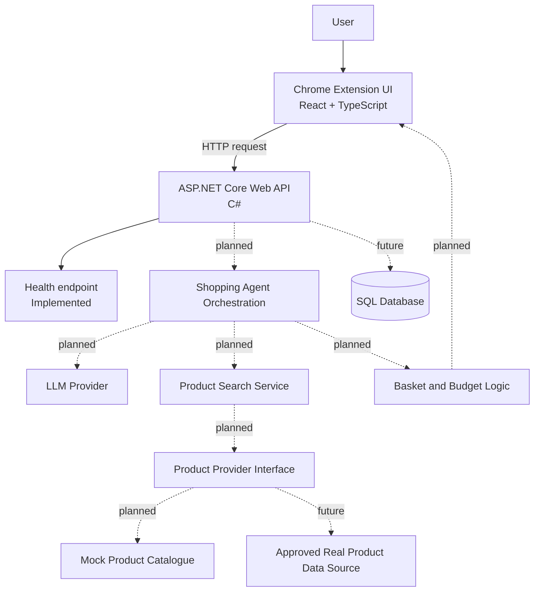

# ShopAI --- Solution Architecture

**Document status:** Initial version\
**Project status:** Early prototype\
**Last updated:** 12 October 2026

## 1. Purpose

This document describes the current and planned architecture of ShopAI,
an AI-assisted shopping Chrome extension. It records the main
components, their responsibilities, how they communicate, and the key
architectural decisions guiding implementation.

The document distinguishes between functionality already implemented and
functionality planned for later milestones.

## 2. System Overview

ShopAI aims to let a user describe a shopping task in natural language,
convert that request into structured requirements, find suitable
products, and prepare a proposed basket for the user to review.

The initial implementation is a local prototype. The React-based Chrome
extension and ASP.NET Core API have been created, and the extension can
successfully call the API health endpoint. AI processing, product
search, basket management, real product-data integration, and cloud
deployment remain planned work.

### 2.1 High-Level Architecture



**Diagram note:** Solid arrows indicate the currently established
user-to-API path or implemented component. Dashed arrows represent
planned components or integrations.

## 3. Architectural Principles

1.  **MVP first:** implement and validate a small end-to-end workflow
    before adding advanced capabilities.
2.  **Separation of concerns:** keep the browser interface, API, AI
    orchestration, product retrieval, and basket rules in distinct
    responsibilities.
3.  **Backend validation:** treat model-generated output as untrusted
    input and validate it before it affects application state.
4.  **Source independence:** isolate product-data access behind a
    provider abstraction so the shopping workflow is not tightly coupled
    to one retailer.
5.  **Human approval:** show proposed products, quantities, and totals
    before any consequential purchasing action. Checkout or purchasing
    automation is outside the initial MVP.
6.  **Secure configuration:** keep API keys and other secrets out of
    source control. Use environment-specific configuration and
    appropriate secret management.
7.  **Incremental infrastructure:** begin locally; introduce SQL,
    Docker, and Azure when the implemented workflow justifies them.

## 4. Components and Responsibilities

### 4.1 Chrome Extension UI

**Technology:** React, TypeScript, Vite, Chrome Extension Manifest V3.

**Responsibilities** - Provide the shopping assistant interface. -
Capture the user's text shopping request. - Display connection and
request states. - Present structured requirements, product
recommendations, and the proposed basket as those capabilities are
implemented. - Ask the user to review and confirm the proposed basket.

**Current state** - Basic popup interface implemented. - Manifest V3
configuration added. - Local API health check implemented.

**Planned** - Replace the temporary alert-based form submission with API
calls. - Display product search results and basket contents. - Add voice
input in a later iteration.

The extension should not contain provider secrets or make privileged
purchasing decisions. Business rules and validation belong on the
backend.

### 4.2 ASP.NET Core API

**Technology:** C# and ASP.NET Core Web API.

**Responsibilities** - Expose HTTP endpoints to the extension. -
Validate requests and return predictable response formats. - Coordinate
requirement extraction, product search, and basket operations as these
are implemented. - Apply server-side business rules and handle errors
consistently.

**Current state** - API project created. - `GET /api/health` returns a
basic health response. - The default template's sample endpoint may have
been removed when the health endpoint was added.

**Planned endpoints** - `GET /api/health` --- service health check. -
`GET /api/products` --- retrieve catalogue products. -
`GET /api/products/search?q=...` --- search products. - Additional agent
and basket endpoints will be defined when their request and response
contracts are designed.

### 4.3 Shopping Agent Orchestration

**Status:** Planned.

The agent orchestration layer will coordinate the shopping workflow
rather than rely on a single free-form model response.

Expected responsibilities: 1. Interpret the user's request. 2. Extract
structured constraints such as event, number of people, budget,
categories, quantities, exclusions, and preferences. 3. Ask for
clarification when required information is missing or materially
ambiguous. 4. Call approved application tools, such as product search
and basket-total calculation. 5. Evaluate product candidates against the
user's constraints. 6. Return a proposed basket with explanations and
any known limitations.

LLM output must be schema-validated and must not be treated as
authoritative for product prices, availability, arithmetic, or purchase
completion.

### 4.4 Product Search and Provider

**Status:** Planned.

Product search will query a catalogue and return products matching terms
and constraints.

A provider abstraction is recommended so the application can start with
mock data and later use a real data source without rewriting the agent
workflow.

Illustrative interface:

```csharp
public interface IProductProvider
{
    Task<IReadOnlyList<Product>> SearchProductsAsync(
        ProductSearchRequest request,
        CancellationToken cancellationToken = default);

    Task<Product?> GetProductAsync(
        string productId,
        CancellationToken cancellationToken = default);
}
```

The exact interface and models should be adjusted to the implemented
requirements. Availability checks should only be added when the chosen
data source can support them reliably.

**Initial data source:** mock/local catalogue.\
**Future data source:** an appropriate, permitted retailer API, product
feed, or other authorised integration. Access to Makro's catalogue has
not yet been established and must not be assumed.

### 4.5 Basket and Budget Logic

**Status:** Planned.

The basket component will manage selected products and quantities,
calculate totals, and report the remaining budget.

Key rules: - Calculate monetary totals in backend code using an
appropriate decimal representation, not floating-point arithmetic. -
Validate quantities and product identifiers. - Distinguish known prices
and availability from missing or stale information. - Explain when the
proposed basket exceeds the budget or cannot satisfy all requirements. -
Require the user to review and confirm the proposed basket.

The initial MVP prepares a basket for review; it does not autonomously
place orders or complete checkout.

### 4.6 Persistence

**Status:** Planned; not required for the first in-memory catalogue
iteration.

A relational database may later persist: - Shopping sessions and
structured requirements. - Basket headers and basket items. - User
preferences, where the user has chosen to save them. - Product cache
entries and data-source metadata, where permitted and useful.

The schema and database technology should be selected when persistence
requirements are clear. SQL is the current direction in the project
roadmap; a specific production database configuration is not yet
established.

### 4.7 External AI and Speech Services

**Status:** Planned.

An LLM service will be used for structured requirement extraction and
selected reasoning tasks. Tool calls will be constrained to
application-defined functions, with input validation and controlled
execution on the backend.

Voice input and speech-to-text are later enhancements. The initial
workflow will use text input so that the core shopping process can be
validated independently of speech recognition.

### 4.8 Hosting and Deployment

**Current environment:** local development on the developer's machine.

**Future direction:** Docker for reproducible backend environments and
Azure for hosting and supporting services, subject to deployment needs
and cost.

Production deployment, monitoring, secret management, and production
CORS settings are not yet implemented.

## 5. Main Data Flow

The intended MVP flow is:

1.  The user enters a shopping request in the extension.
2.  The extension sends the request to the ASP.NET Core API.
3.  The API validates the request.
4.  The agent extracts structured shopping requirements.
5.  The agent requests matching products from the product search
    service.
6.  The backend evaluates candidates and calculates basket totals.
7.  If necessary, the agent asks the user a targeted clarification
    question.
8.  The API returns the proposed basket and relevant explanations.
9.  The extension displays the result.
10. The user reviews and confirms the proposal before any consequential
    next step.

Only the extension-to-health-endpoint connectivity portion of this flow
is currently implemented. The remaining steps are planned.

## 6. API and Integration Boundaries

### 6.1 Frontend-to-Backend Contract

The extension communicates with the API using HTTP and JSON. Endpoint
paths, request schemas, response schemas, and error formats should be
documented as endpoints are implemented.

The local frontend configuration must use the actual HTTP host and port
printed by the API at startup.

### 6.2 CORS and Local Development

A CORS policy has been configured for local development to permit the
extension origin and local Vite origins. The extension manifest includes
host permissions for localhost addresses.

These settings are development conveniences, not production security
controls. Before deployment: - Restrict allowed origins to the actual
deployed extension origin and approved development origins. - Use HTTPS
for hosted API communication. - Review extension permissions and remove
any that are unnecessary. - Do not treat CORS as authentication or
authorisation.

### 6.3 Product Data Integration

The application must not assume that a retailer provides a public API or
that scraping is permitted. The product integration method must be
assessed for technical feasibility, terms of use, rate limits, data
freshness, and permitted storage or caching before implementation.

## 7. Security and Reliability Considerations

The following are architectural requirements to address as the product
develops:

- Validate all client input and all LLM-generated structured output.
- Keep LLM and retailer credentials on the server, not in extension
  code.
- Apply sensible request size limits, timeouts, cancellation, and
  error handling.
- Avoid logging secrets or unnecessary personal information.
- Use explicit user approval before consequential shopping actions.
- Make uncertainty visible when price, stock, package size, or product
  matching is uncertain.
- Protect persisted user data with appropriate authentication,
  authorisation, and access controls when accounts or saved sessions
  are introduced.
- Test budget calculations, quantity rules, substitutions, and
  unavailable-product handling.
- Configure production CORS narrowly and use HTTPS.

## 8. Key Architectural Decisions

---

Decision Current direction Rationale /
qualification

---

Browser experience Chrome extension, The product is intended
Manifest V3 to assist users while
shopping in the
browser.

Frontend React + TypeScript + Supports a
Vite component-based
interface and typed
frontend code.

Backend C# + ASP.NET Core Web Provides a separate API
API boundary for business
logic and integrations.

Initial product data Mock catalogue Enables product search
and matching to be
developed before
external integration is
available.

Initial interaction Text-first Validates the core
workflow before adding
speech recognition.

Agent execution Backend-controlled Keeps integrations,
tools validation, and
business rules under
application control.

Purchase actions User review and Prevents an early
confirmation prototype from taking
consequential actions
autonomously.

Persistence Introduce SQL when Avoids unnecessary
needed database setup before
the initial catalogue
and workflow are
validated.

Deployment Local first; Docker and Keeps early development
Azure later focused on product
functionality.

---

These are working decisions and may be revised when requirements or
integration constraints change.

## 9. Current Repository Structure

The intended repository structure is:

```text
ai-shopping-agent/
├── client/
│   └── extension/
│       ├── public/
│       ├── src/
│       ├── manifest.config.ts
│       ├── vite.config.ts
│       └── package.json
├── server/
│   └── AiShoppingAgent.Api/
│       ├── Program.cs
│       └── AiShoppingAgent.Api.csproj
├── docs/
│   └── architecture.md
├── .gitignore
└── README.md
```

This is a target outline; retain any additional files generated by the
tools and SDKs. Update this section if the actual repository structure
differs.

## 10. Implementation Milestones

1.  **Foundation --- completed:** React/TypeScript extension, Manifest
    V3 build, ASP.NET Core API, health endpoint, and local connectivity
    check.
2.  **Product catalogue --- next:** define product models, seed mock
    products, and implement retrieval/search endpoints.
3.  **Shopping request API:** define request/response contracts and
    validate incoming shopping requests.
4.  **Structured AI extraction:** convert natural-language requests into
    validated requirements.
5.  **Product matching and basket:** search candidates, calculate
    totals, and return a proposed basket.
6.  **Clarification and edge cases:** handle missing details,
    unavailable products, substitutions, and budget conflicts.
7.  **Voice input:** add speech-to-text after the text workflow is
    stable.
8.  **Real product data:** integrate an appropriate authorised data
    source if available.
9.  **Hardening and deployment:** add tests, persistence where
    justified, production configuration, monitoring, and deployment.

## 11. Open Questions

- Which permitted product-data source will be used for the real
  catalogue?
- Which LLM provider and structured-output capabilities will be
  selected?
- What price and availability freshness guarantees can the product
  source provide?
- What should happen when the request cannot be satisfied within the
  budget?
- Which shopping-session data should be saved, and for how long?
- What authentication, if any, is required for the first public
  deployment?
- Which Azure services and hosting configuration fit the expected
  usage and budget?

These questions should be resolved before the related integrations or
production capabilities are committed to.

## 12. Maintenance

Update this document when a material architectural decision changes, a
new system component is introduced, an integration boundary changes, or
a planned component becomes implemented. Keep the current-state
descriptions accurate and distinguish implemented behaviour from future
intent.
